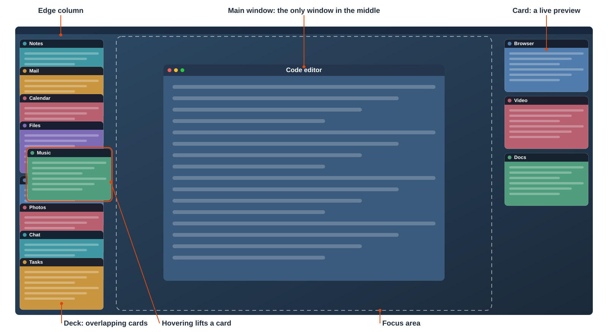
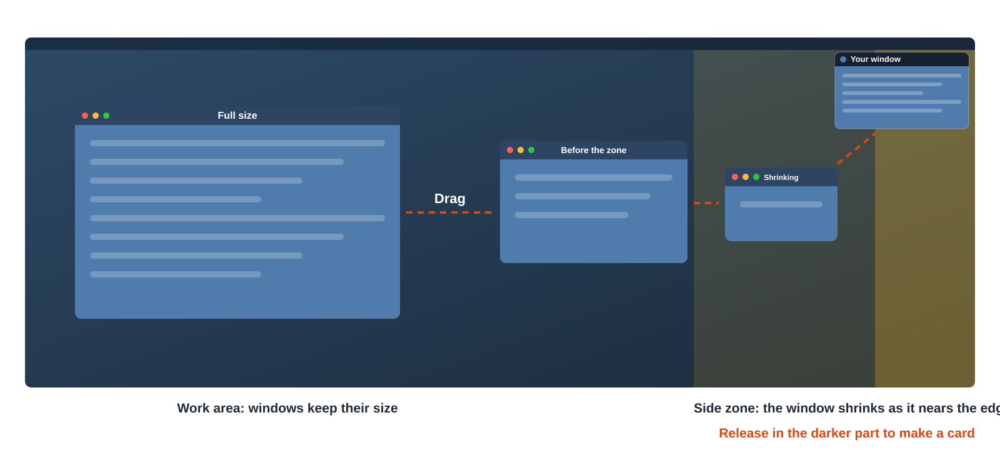
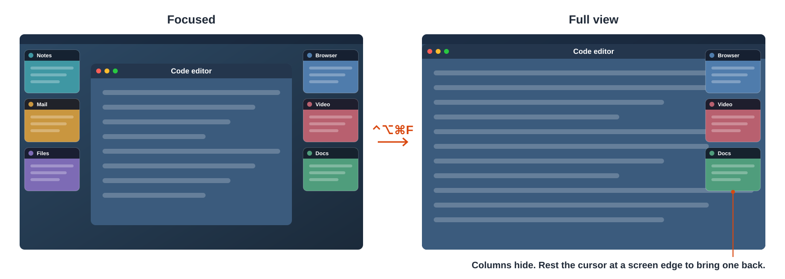

# SpaceMemory

A macOS window manager for wide screens. The window you're using stays in the center, and every other window waits at the screen edges as a small live preview.



*An illustration of focus mode, not a screenshot, with the main terms labeled.*

> **Status: prototype.** It has been tested with automated, simulated input on one display, on macOS 26. Real-world feel and multi-monitor setups are untested. See [Known limits](#known-limits).

## Terminology

| Term | Meaning |
| --- | --- |
| **Focus mode** | The working state: one window in the center, and all the others as cards. |
| **Focus area** | The space between the edge columns. It holds one window at a time. |
| **Main window** | The window currently in the focus area. |
| **Card** | A live preview of a window, showing its app icon and title. A card is view-only. |
| **Edge column** | A stack of cards along the left or right screen edge. |
| **Deck** | An edge column too full to fit, with its cards overlapping so their headers stay visible. |
| **Side zone** | The outer part of the screen on each side, where a dragged window shrinks. |
| **Docking** | Turning a window into a card. Its real window is moved almost entirely off-screen, which is called parking. |
| **Promoting** | Bringing a window into the focus area. The previous main window is docked. |
| **Shake** | Grabbing a window's title bar and moving it quickly back and forth. |
| **Focused view** | The main window sits between the edge columns. |
| **Full view** | The main window fills the usable screen on the current desktop, and the edge columns hide. |
| **Native full screen** | The macOS green-button mode, which puts a window in its own Space. It's separate from full view. |
| **Reveal** | Bringing a hidden edge column back by resting the cursor at that screen edge. |

## Using it

### Docking a window

Drag a window toward a side. It shrinks through the side zone, and releasing it near the edge makes it a card. Drag it back before releasing and it returns to full size.



### Focus mode

| Action | Result |
| --- | --- |
| Shake a window | Starts focus mode: that window becomes the main window, and the others become cards. |
| Shake the main window again | Ends focus mode: every window returns to its original position and size. |
| ⌃⌥⌘F | Starts focus mode on the front window, then switches between focused view and full view. |
| Restore All Windows, in the menu bar | Ends focus mode from anywhere. |

### Switching windows

Whichever window you switch to is promoted, however you get there.

| Action | Result |
| --- | --- |
| Click a card | Promotes that window. |
| ⌘Tab or a Dock click | Promotes the focused window of that app. |
| ⌘\` | Promotes another window of the same app. |
| Open a new window | Promotes the new window. |
| ⌥Tab, during focus mode | Tap to return to the last window. Hold ⌥ and keep tapping Tab to step through recent windows, then release to switch. |

### Full view

The main window fills the screen, and the edge columns slide away. Switching windows keeps you in full view. Press ⌃⌥⌘F or drag the window to return to focused view.



Any front window covering more than half a column's width hides that column, including one in native full screen. A card you've just docked stays visible until the cursor leaves its column.

### Dragging content between windows

While dragging a file, text or an image in focus mode:

- **Hold it over a card** for about half a second to promote that window, then drop into it.
- **Press ⌘Tab or ⌥Tab** to switch windows without letting go.

Dropping directly on a card is refused, so content can't land on the desktop behind it.

### Crowded columns

Hover over a deck to lift a card, and move along the column to flip through the cards. Click to promote the one you want.

## Install and run

You need macOS 14 or later and Xcode or the Swift command line tools.

```bash
./scripts/build.sh
```

```bash
open build/SpaceMemory.app
```

The app lives in the menu bar. On first launch, turn it on in **System Settings > Privacy & Security** under both of these:

- **Accessibility**, to move and resize other apps' windows
- **Screen & System Audio Recording**, to show live previews (audio isn't captured)

To change the ⌃⌥⌘F shortcut, choose **Change Shortcut…** in the menu bar. Quitting from the menu bar puts every window back.

## How it works

macOS doesn't let an app scale another app's window, so SpaceMemory never actually shrinks one. A card is a floating panel showing a live ScreenCaptureKit stream of the real window, which is parked at the bottom-right corner of the desktop with a thin strip still on screen.

| File | Purpose |
| --- | --- |
| `Sources/SpaceMemory/main.swift` | Launcher that loads the library. Changing it means granting permissions again. |
| `Sources/SpaceMemoryCore/WindowManager.swift` | Docking, focus mode, promoting, decks and hidden columns |
| `Sources/SpaceMemoryCore/WindowCapture.swift` | Live preview streams and card panels |
| `Sources/SpaceMemoryCore/AXWindow.swift` | Moving other apps' windows through the Accessibility API |
| `Sources/SpaceMemoryCore/EventTap.swift` | System-wide left mouse button handling |
| `Sources/SpaceMemoryCore/ShakeDetector.swift` | Shake detection |
| `Sources/SpaceMemoryCore/Shortcut.swift` | Global shortcuts and the Change Shortcut window |
| `Sources/SpaceMemoryCore/Support.swift` | Screen geometry, side zones, card size and logging |
| `Sources/SpaceMemoryCore/Probe.swift` | Automated checks |

## Automated checks

These take over the mouse and keyboard, and move real windows before putting them back. Don't use the computer while they run. Results go to `~/Library/Logs/SpaceMemory.log`, with images in `~/Library/Logs/SpaceMemory-probe/`.

```bash
open -n build/SpaceMemory.app --args --check-gestures TextEdit --check-switching TextEdit,Safari --quit-after-checks
```

| Flag | Checks |
| --- | --- |
| `--check-windows Apps` | Moving, parking and capturing windows |
| `--check-gestures Apps` | Docking, shake, decks and hover |
| `--check-switching App1,App2` | One window in the focus area, ⌘Tab, ⌥Tab, ⌘\` and full view |
| `--check-fullview App` | Full view, hidden columns and native full screen |
| `--check-drag Chrome,TextEdit` | Dragging content. Open `Resources/drag-test-page.html` in Chrome and a TextEdit file named `drag-target` first. |
| `--check-dropped-card` | Docking with a large window in front. Open the same page in Chrome and a TextEdit file named `snap-test` first. |
| `--check-shortcut set`, then `verify` | Changing the shortcut, across a restart |

## Known limits

- **Cards are view-only.** You can't click into one or drag content out of it. Promote the window first.
- **Focus mode is opt-in.** Outside it, windows behave normally and can overlap.
- **Other Spaces:** cards don't update while you're in another Space, and windows on other Spaces aren't managed.
- **Native full screen:** clicking a card switches you back to the desktop, because macOS has no public way to move a window between Spaces.
- **Multiple displays** are untested.
- **Shortcut clashes:** macOS doesn't report them, so if another app uses the same combination, both respond. ⌥Tab can't be changed yet.
- **Chrome after native full screen:** in the checks, a Chrome window stopped responding to simulated title-bar drags after leaving native full screen, so shaking it failed. This hasn't been tried by hand. Restore All Windows still works.
- **Partly covered columns:** a window covering less than half a column's width doesn't hide it, so cards can float over that window's edge.
- **Distribution:** the app is signed for local use only. Sharing it would need a Developer ID and notarization. It also uses one private API, to match Accessibility windows to their capture streams, which rules out the App Store along with its sandbox.
